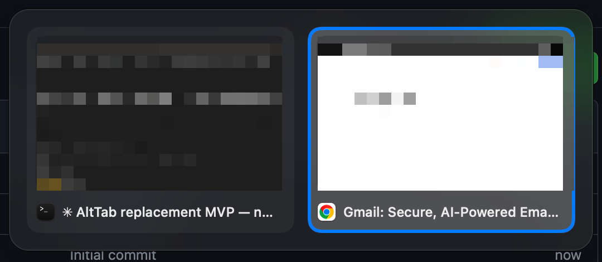

# Focal

Fast window switching and snapping for macOS, living in your menu bar. Everything stays on your Mac.



## Features

- **Window switcher**: hold <kbd>⌥</kbd> and press <kbd>Tab</kbd> to cycle through windows in most-recently-used order, with live thumbnails. Add <kbd>⇧</kbd> to cycle backwards.
- **Window snapping**: snap the focused window to the left half, right half, or maximize it.
- **Custom shortcuts**: rebind any action from *Shortcuts & Setup…* in the menu bar.
- **Launch at login** toggle in the menu bar.

### Default shortcuts

| Action | Shortcut |
| --- | --- |
| Switch windows | <kbd>⌥</kbd> <kbd>Tab</kbd> |
| Snap left half | <kbd>⌥</kbd> <kbd>⇧</kbd> <kbd>←</kbd> |
| Snap right half | <kbd>⌥</kbd> <kbd>⇧</kbd> <kbd>→</kbd> |
| Maximize | <kbd>⌥</kbd> <kbd>⇧</kbd> <kbd>↑</kbd> |

## Requirements

- macOS 14 or later
- Swift 5.9+ toolchain (Xcode or Command Line Tools)

## Build and run

```sh
Scripts/bundle.sh run
```

This builds `build/Focal.app` and launches it. The script signs with a "Focal Dev" code-signing identity if you have one (so the Accessibility grant survives rebuilds); otherwise it signs ad-hoc, and macOS will ask for permission again after each build. Set `SIGN_ID` to override.

## Permissions

On first launch, Focal walks you through granting:

- **Accessibility**: required to capture the global hotkeys and to raise and move windows.
- **Screen Recording**: required to show window thumbnails in the switcher.

Enable Focal under System Settings → Privacy & Security.

## Project layout

```
Sources/Focal/
  Core/     Accessibility helpers, permissions, logging
  Input/    Global hotkeys and user-editable shortcuts
  UI/       Switcher, settings, and onboarding views
  Windows/  Window discovery, MRU tracking, thumbnails, snapping
Scripts/bundle.sh   Builds and signs Focal.app
```

## License

[MIT](LICENSE)
